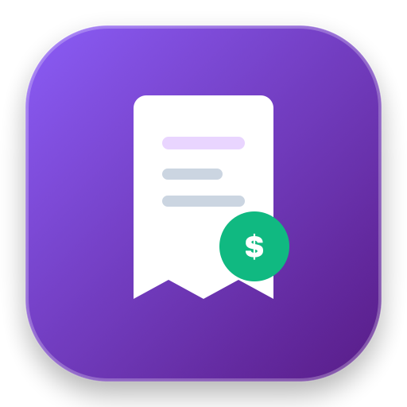
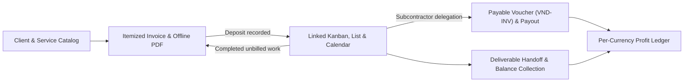

<div align="center">
  
  <h1>BillFlow</h1>
  <p>Local-first desktop workspace for client billing, task execution, subcontractor payouts, and profit tracking.</p>
  <p>
    <a href="package.json"></a>
    <a href="https://www.electronjs.org/"></a>
    <a href="https://nextjs.org/"></a>
    <a href="https://www.sqlite.org/"></a>
    <a href="https://www.typescriptlang.org/"></a>
  </p>
</div>

Independent software developers and technical consultants often manage client agreements in docs, tasks on a Kanban board, payments in spreadsheets, and contractor briefs in chat. BillFlow keeps clients, itemized invoices, deliverables, vendor payouts, receipts, and per-currency cashflow inside one desktop application on macOS and Windows.

All records, payment receipts, and backups live on disk in a local SQLite database without cloud accounts, telemetry, or remote servers.

## How the billing and delivery loop works



Recording a client deposit (`ADVANCE_PAID`) opens a 5-second prompt to turn invoice line items into Kanban cards without retyping scope. Unbilled tasks marked `Done` also import directly into a new invoice individually or in batches, and sibling cards from the same invoice highlight together on hover.

## Product capabilities

### Client directory and reusable service catalog

Save permanent clients with default currencies (`USD`, `LKR`, `EUR`, `GBP`, `CAD`), contact details, and delivery destinations such as Google Drive folders or code repositories. For one-off work, enter temporary client details straight into the invoice editor without polluting the directory. Maintain fixed-fee or hourly rate cards in the service catalog and import or export rows via CSV or Excel workbooks.

### Itemized invoicing and five offline PDF templates

Build multi-currency invoices with catalog items, custom discounts, taxes, and upfront deposit rules. Generate and save PDF files locally via Electron `printToPDF` and `pdf-lib` with bundled typography and an optional uploaded business logo. Five selectable invoice layouts are included offline:

- `Geometric Teal`: teal and slate angled header on a white sheet
- `Executive Wave`: charcoal curved ribbon header with amber summary styling
- `Scarlet Modern`: split red header and dotted item rows
- `Apex Orange`: orange diagonal header and bordered table grid
- `Noir Crimson`: dark invoice sheet with crimson capsule rows

Dispatch invoices or overdue reminders through prefilled `wa.me` WhatsApp links or email drafts, inspect past-due accounts receivable aging (`1-15`, `16-30`, `31-60`, `60+` days), and export active registers or aging reports to RFC 4180 CSV or Excel formats.

### Task board, local calendar, and deliverable handoff

Switch between Kanban (`To Do`, `In Progress`, `Under Review`, `Done`), List, and Calendar views. Active work time accumulates in the background on cards, and Calendar view supports drag-and-drop rescheduling alongside two-way local macOS Calendar `.ics` synchronization on desktop. Dragging a deliverable card to `Done` opens the Submit Work modal with direct links to that client's repository, staging URL, or Drive folder.

### Subcontractor outsourcing and automated payout ledger

Delegate any Kanban card to an external vendor with prefilled scope, client references, delivery URLs, payout fees, and deadlines. Export payable work orders (`VND-INV-xxxx`) offline via `pdf-lib` and send formatted briefs over WhatsApp. Deliverable approval and vendor settlement remain separate states; marking a voucher `Paid` records an operational payout entry in the expense ledger automatically.

### Operational expenses, receipt vault, and net profit

Log business expenses with custom merchant icons, recurring flags, and SHA-256 content-addressed receipt attachments (`PNG`, `JPG`, `PDF`) opened through the OS viewer. Financial summaries and Apache ECharts visualizations separate totals strictly by currency (`gross invoiced revenue - operational expenses - settled vendor payouts`). Losses and negative margins remain visible as entered, without zero-clamping or synthetic sample records.

### Multi-profile workspaces and backups

Run up to 5 isolated local workspaces in one installation, starting from role presets for Software Engineering, AI Development, or Consulting. Each profile keeps its own database, receipts directory, catalog defaults, appearance settings (`Light`, `Dark`, or `System` with accent themes), and optional 4-digit PIN or alphanumeric passcode enforced in Electron's main process. Export or restore version 2 JSON backups that bundle tasks, schedules, and receipt bytes (`150 MiB` maximum backup size, `100 MiB` maximum per attachment, `50,000` rows per table).

## System architecture

| Layer | Stack | Role |
| :--- | :--- | :--- |
| Desktop shell | Electron 44 | Context-isolated `window.billflow` preload bridge, single-instance window management, local tray controls |
| Interface | Next.js 16 (App Router), React 19 | Static bundle (`output: 'export'`) loaded from loopback static protocol in packaged builds |
| Styling and motion | Tailwind CSS v4, Motion | Custom surface tokens, Newsreader and Inter typography, reduced-motion support |
| Database and validation | SQLite (`better-sqlite3`), Drizzle ORM, Zod | WAL journal mode, foreign-key cascades, versioned schema migrations, schema-checked IPC payloads |
| Documents and analytics | `pdf-lib`, Electron `printToPDF`, Apache ECharts 6 | Local PDF invoices and contractor vouchers, multi-currency financial and turnaround charts |
| Testing | Vitest, Playwright | Database integrity, security, offline PDF generation, and packaged Electron end-to-end tests |

## Running from source

### Prerequisites

- Node.js `v22` LTS (`.nvmrc` specifies `22`; `package.json` supports `>=22 <27`)
- npm `v10` or newer
- macOS (Apple Silicon or Intel) or Windows 10/11

### Setup and launch

```bash
git clone https://github.com/Akatsuki-61/BillFlow.git
cd BillFlow
npm install
```

`npm install` runs `electron-builder install-app-deps` automatically to align native `better-sqlite3` bindings with Electron 44.

Launch the desktop app in development mode (Next.js dev server bound to `127.0.0.1` plus Electron shell with live watch):

```bash
npm run dev:electron
```

Build the static renderer and main-process bundle, then start the packaged local desktop entrypoint without a Next.js server:

```bash
npm run build
npm start
```

If you only want the browser preview using the in-memory fallback provider at `http://127.0.0.1:3000`:

```bash
npm run dev
```

## Verification and packaging

Run type checks, ESLint, and the Vitest suite (`210` tests across `27` files):

```bash
npx tsc --noEmit
npm run lint
npm test
```

Build an ad-hoc signed local macOS Apple Silicon `.app` preview under `release/preview-0.2.0/mac-arm64/BillFlow.app` and run the Playwright desktop suite against it:

```bash
npm run pack:mac
npm run test:desktop
```

Create distributable installers into `release/`:

```bash
npm run dist:mac:arm64   # macOS Apple Silicon (.dmg)
npm run dist:mac         # macOS arm64 + x64 (.dmg)
npm run dist:win         # Windows x64 NSIS setup (.exe)
```

## Local data storage

| Environment | Database location |
| :--- | :--- |
| macOS packaged app | `~/Library/Application Support/BillFlow/billflow.db` |
| Windows packaged app | `%APPDATA%\BillFlow\billflow.db` |
| Development (`npm run dev:electron`) | `./.billflow-dev/billflow.db` |

Additional local files stay in the same `userData` directory: SHA-256 receipt attachments under `attachments/`, isolated secondary workspaces under `profiles/<profile-id>/`, theme state in `appearance.json`, and automatic `billflow.db.before-upgrade-*.bak` recovery copies created ahead of pending Drizzle migrations. Generated PDFs export to the folder configured in Settings (defaulting to Downloads).

## Project background and credits

BillFlow was originally developed for **EER4189 Software Design in Group** (Group 61) at The Open University of Sri Lanka and is maintained by team Akatsuki-61. See [CONTRIBUTIONS.md](CONTRIBUTIONS.md) for the full module breakdown and development history.

| Contributor | GitHub | Area |
| :--- | :--- | :--- |
| Nipun Yatawara | [@nipunyatawara-dev](https://github.com/nipunyatawara-dev) | Architecture, Electron shell, SQLite/Drizzle schema, multi-profile workspaces, task-to-invoice flow, motion tokens |
| GVSL-Lahiru | [@GVSL-Lahiru](https://github.com/GVSL-Lahiru) | Lead QA, deliverable handoff workflow, overdue aging summaries, CSV exports, navigation polish |
| Binuka Reshan | [@Binukareshane](https://github.com/Binukareshane) | Subcontractor outsourcing engine, payable vouchers (`VND-INV-xxxx`), WhatsApp dispatch, ledger expense posting, Excel exports |
| Sandika | [@Sandika-2003](https://github.com/Sandika-2003) | Service catalog, bulk CSV/Excel imports, UI integration, invoice sheet preview, macOS Calendar `.ics` sync |
